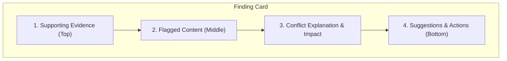

# Project Context: Inkloom AI — Evidence-First Verification Architecture

## 1. Overview & Objectives

Inkloom AI's intelligence and verification layer evaluates creator submissions against internal brand guidelines (Supabase RAG) and external factual claims (Exa search). The core finding presentation has been enhanced to follow an **Evidence-First** paradigm without replacing or disrupting the existing AI intelligence, pipeline orchestration, or human-review workflows.

---

## 2. Evidence-First Finding Architecture

Every compliance finding is presented in four logically and visually structured sections:

### Section 1: Supporting Evidence (Top)
- **Structural Separation:** Internal Supabase RAG guidelines and External Exa/web sources are displayed in dedicated, visually distinct containers (`.evidence-block.internal` vs. `.evidence-block.external`).
- **Internal RAG Metadata:** Shows available document title, section, page number, chunk ID (`#chunk_id`), similarity match percentage, and source reference.
- **External Web Metadata:** Shows available title, domain, publication date, evidence quality rating, excerpt, and verified direct URL link.
- **Evidence Modes:** Supports four explicit modes:
  - `internal_only`: Only brand guideline rules apply.
  - `external_only`: Only external web/fact verification applies.
  - `combined`: Both internal guidelines and external facts support or refute the statement.
  - `insufficient_evidence`: Explicit callout indicating a gap in evidence where human review is required before publication.
- **Missing Metadata Safeguard:** Missing metadata (such as page number or chunk ID) is omitted cleanly; missing fields are never invented or hallucinated.

### Section 2: Flagged Content (Middle)
- **Precise Offending Words Highlighted:** When the offending span is reliably established within the surrounding passage, the exact words are highlighted (`<mark className="offending-words-highlight">`).
- **Character Offset Validation:** Validated `[start_char, end_char]` indices are tracked in `FlaggedSpan`.
- **Repeated Phrase Handling:** Repeated phrases are disambiguated by matching within the surrounding sentence/passage context before falling back to first occurrence.
- **Non-Fabrication Fallback:** If exact character offsets cannot be reliably established, the original passage is displayed without fabricating artificial highlights.
- **Interactive Draft Linking:** Clicking the flagged content highlights its exact position in the user's submitted draft text on the left panel.

### Section 3: Conflict Explanation & Impact
- **Draft vs. Evidence Explanation:** Plain-language explanation detailing what the draft claims, what the evidence requires, and why they conflict.
- **Governance Impact (`why_it_matters`):** Concrete explanation of business, commercial, legal, or brand consistency risks.
- **Uncertainty & Human Attention:** Displays explicit `uncertainty_note` and triggers a `Human Review Required` badge when automated certainty is not achieved.

### Section 4: Suggestions & Actions (Bottom)
- **Minimal Intent-Preserving Corrections:** Minimal replacements preserving core entities and meaning.
- **Token-Level Diff Preview:** Visual additions/removals diff using token comparison.
- **Change Rationale & Preserved Entities:** Surfaces explanation and tagged entity chips (dates, metrics, names).
- **Workflow Action Buttons:**
  - `Accept change`: Applies correction to submission draft text.
  - `Preview recheck`: Simulates recheck to verify whether the issue is resolved and whether new findings emerge.
  - `Dismiss finding`: Resolves the finding with audit log tracking.
  - `Edit manually`: Opens the draft editor for direct creator revision.

---

## 3. Exact Guideline Violation Verification Rules

To prevent AI hallucination or misattribution:
1. **Verbatim Substring Enforcement:** `extract_verbatim_guideline_passage()` strictly verifies that a candidate violated rule is an exact substring of the retrieved Supabase RAG chunk.
2. **Rejection of Paraphrases:** If the model generates an AI summary or paraphrase of a rule, it is **never** labeled as an exact quotation. The field remains `None`, and the full retrieved chunk is displayed instead.
3. **Full Chunk Context:** When an exact rule is verified, it is emphasized in a `.verbatim-guideline-box` while the full retrieved chunk remains accessible within a collapsible `
` disclosure box.

---

## 4. Data Models & Backward Compatibility

All enhancements maintain 100% backward compatibility with existing API contracts, database persistence, and text-replacement endpoints:

### Schema Additions (`backend/app/models.py`)
- `EvidenceMode`: Literal enum (`"internal_only"`, `"external_only"`, `"combined"`, `"insufficient_evidence"`).
- `InternalEvidence`: Contains `document`, `document_id`, `chunk_id`, `section`, `passage_ref`, `page_number`, `similarity`, `exact_violated_passage`, with automatic synchronization between `retrieved_chunk_text` and `excerpt`.
- `ExternalEvidence`: Contains `title`, `url`, `domain`, `published_date`, `retrieved_at`, `excerpt`, `evidence_quality`, `status`, `error_reason`.
- `FlaggedSpan`: Contains `exact_text`, `start_char`, `end_char`, `surrounding_passage`, `location_label`.
- `SuggestionDetails`: Contains `suggested_replacement`, `change_rationale`, with synchronization between `entities_preserved` and `preserved_entities`.

### Bidirectional Model Syncing
In `FlagDraft` and `Flag`:
- When new structured evidence (`internal_evidence`, `external_evidence`, `flagged_span`, `suggestion`) is provided, legacy fields (`passage`, `location`, `guideline_ref`, `guideline_refs`, `external_sources`, `suggested_correction`) are automatically populated.
- When legacy fields are provided (e.g. from existing test fixtures or demo data), structured evidence containers and `evidence_mode` are automatically inferred and populated.
- Text resolution via `POST /submissions/{id}/flags/{flag_id}/resolution` continues to execute safely via single-occurrence replacement `sub.text.replace(target_flag.passage, target_flag.suggested_correction, 1)`.

---

## 5. Modified Files & Verification Summary

| File | Subsystem | Modifications |
| :--- | :--- | :--- |
| `backend/retrieval/schemas.py` | Retrieval | Added chunk metadata to `GuidelineRef` and web search metadata to `ExternalSource`. |
| `backend/retrieval/brand_rag.py` | Retrieval | Forwarded Supabase chunk metadata (`chunk_id`, `page_number`, `similarity`, etc.). |
| `backend/retrieval/external_search.py` | Retrieval | Forwarded Exa web search metadata (`title`, `domain`, `published_date`, etc.). |
| `backend/app/models.py` | Domain Models | Added `EvidenceMode`, `InternalEvidence`, `ExternalEvidence`, `FlaggedSpan`, `SuggestionDetails`, with bidirectional synchronization. |
| `backend/app/pipeline.py` | Pipeline | Forwarded new evidence containers in `_draft_to_flag()` and `_make_error_flag()`. |
| `backend/app/ai/schemas.py` | AI Layer | Added exact violated passages, offending words, and evidence fields to output models. |
| `backend/app/ai/brand_verification.py` | AI Layer | Added `extract_verbatim_guideline_passage()` and `locate_flagged_span()`; updated grounding. |
| `backend/app/ai/claim_verification.py` | AI Layer | Updated claim finding draft converter to build `ExternalEvidence` and `FlaggedSpan`. |
| `backend/app/ai/flagging.py` | AI Layer | Preserved structured evidence and spans during flag synthesis and deduplication. |
| `backend/app/plugins/brand_check.py` | Plugins | Passed submission text to enable span offset calculation. |
| `backend/app/plugins/verification.py` | Plugins | Passed submission text to enable span offset calculation. |
| `frontend/src/serverApi.ts` | Frontend Types | Extended TypeScript types for `ServerFlag` and evidence models compatibly. |
| `frontend/src/ReviewWorkspace.tsx` | Frontend UI | Implemented 4-section evidence-first card layout and offset-based text highlighting. |
| `frontend/src/ReviewWorkspace.css` | Frontend Styles | Added styles for evidence blocks, verbatim quotes, metadata chips, and highlights. |
| `backend/tests/test_evidence_first.py` | Tests | Comprehensive 14-test suite for verbatim extraction, offsets, and evidence modes. |

### Verification Results
- **Backend Test Suite:** 163 of 163 tests passed (100% pass rate).
- **Frontend TypeScript Build:** `tsc -b && vite build` passed with 0 errors.
- **Frontend Lint:** `oxlint` passed with 0 errors.
