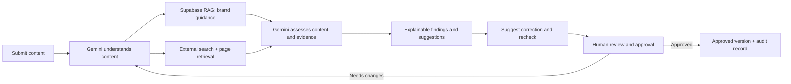

# Inkloom AI — Brand Governance Platform (Team OFFSCRIPT)

A pre-publication review platform that checks content against approved brand guidance and external evidence, explains every finding, suggests minimal intent-preserving fixes, and keeps humans in charge of approval.

> Status: Round 2 build in progress. Items marked **(TBC)** are not yet confirmed by the team.

---

## 1. Problem

Organisations publish through many employees, agencies and AI tools. Incorrect claims, outdated facts, inconsistent language and off-brand visuals can damage credibility before anyone notices.

**Challenge (Inkloom AI):** build a brand-governance platform that reviews content before publication against approved guidelines, facts and assets, and:

- detects issues in tone, terminology, messaging, visual consistency, accessibility and unsupported promotional claims;
- explains each issue and suggests corrections that preserve the creator's purpose (no blunt rejection);
- supports creator / manager / authorised-reviewer collaboration with comments, approvals and revision history;
- supports multiple content formats and gives governance insights (recurring mistakes, unclear guidelines);
- balances automation with human control, protects confidential material, and discloses AI/external service use.

## 2. Our solution

Two connected checks feed one explainable assessment:

1. **Brand check:** retrieve approved internal guidance (guidelines, terminology, facts) via Supabase RAG.
2. **External evidence check:** find and read web sources for claims needing support.

Gemini compares the draft with the retrieved material and produces findings. Suggested corrections are rechecked, uncertain results are escalated, and a human makes the final decision. **The system never publishes automatically.**

### End-to-end workflow

1. **Submit** a text draft, image or PDF.
2. **Understand:** Gemini identifies claims, passages, purpose, audience, tone and intended message.
3. **Retrieve brand guidance:** Supabase vector search over approved guidelines, terminology and facts.
4. **Retrieve external evidence:** claim-focused search, page retrieval, URLs and excerpts stored.
5. **Assess:** brand findings are *aligned / potential issue / unclear*; claim findings are *supported / contradicted / insufficient evidence*. Visual and accessibility checks included.
6. **Explain:** each flag shows the passage and location, why it matters, and the guideline or source behind it.
7. **Suggest and recheck:** a minimal edit is proposed, then rechecked for new brand conflicts, unsupported claims and changes to protected details (e.g. offer conditions).
8. **Review and decide:** creator revises and comments, manager reviews, authorised reviewer approves or requests changes.
9. **Record:** versions, comments, decisions and audit events are stored.

### What every flag contains

- The flagged sentence, claim or visual element, and its location (page / paragraph).
- Plain-language explanation and why it matters.
- The approved guideline or fact involved, with a source reference.
- External source links and the retrieved excerpts used.
- An uncertainty state when evidence is missing, outdated, conflicting or insufficient.
- A minimal suggested correction.
- Review status and subsequent human comments/decisions.

## 3. Tech stack

| Component | Role |
|---|---|
| **Gemini (Flash-Lite tier per Round 1 deck; exact model string TBC)** | Multimodal understanding, claim extraction, assessment, explanations, corrections |
| **Supabase** | PostgreSQL, file storage, `pgvector` RAG, users/roles, reviews, versions, audit events |
| **External search** | Finds candidate sources for a claim. Round 1 deck says TinySearch; Ken's brief says Exa **(TBC)** |
| **Page retrieval** | Fetches selected pages. Round 1 deck says TinyFetch; Ken's brief says TinyFish **(TBC)** |
| **OCR** | Text extraction from scanned PDFs and images (tool TBC) |
| **FastAPI** | Backend API coordinating submissions, AI calls, retrieval, workflow state |
| **Frontend** | Dashboard and review UI (framework TBC) |

Objective checks such as **colour contrast** use dedicated calculations (WCAG), not the LLM; the visual model flags *potential* accessibility issues only.

## 4. Key features

- **Two-source verification:** internal brand material plus external evidence.
- **Evidence-linked explanations** reviewers can verify.
- **Intent-preserving corrections** with recheck.
- **Role-based human workflow:** creator, manager, authorised reviewer; states: draft → AI review → manager review → final approval → approved.
- **Traceability:** versions, comments, source references, audit log (user, action, timestamp).
- **Governance insights:** recurring issues, repeated violations, potentially unclear guidelines.
- **Multimodal:** text, images, PDFs.

## 5. Trust, privacy and reliability

- AI output is a recommendation, not a guarantee of truth or compliance.
- Missing, outdated or conflicting evidence is marked uncertain and routed to a human.
- Drafts and brand documents are treated as confidential: role-based access, secure file access, retention/deletion rules.
- Confidential material is not sent to external services unless the organisation has configured and accepted that; use of AI and external services is disclosed in the UI.
- Unavailable sources (timeouts, 403/404, paywalls) degrade to *insufficient evidence* rather than failing.

## 6. Team and ownership

| Member | Area | Responsibilities |
|---|---|---|
| **Ken** | Retrieval and Evidence | Supabase RAG (chunking, embeddings, vector search); brand knowledge base ingestion and updates of outdated docs; external search and page retrieval; claim-focused queries; source URLs, freshness, publication dates, unavailable-source handling; OCR and text extraction |
| **Sera** | AI Intelligence and Verification | Gemini content understanding; claim extraction; brand and external claim verification; flagging with explanations and uncertainty; corrections and recheck; visual and accessibility intelligence; governance pattern detection |
| **Gaurav** | Backend and Data | FastAPI; Supabase DB/storage/auth; RBAC and secure file handling; review workflow states; versioning, comments, audit logs; upload/OCR pipeline coordination; contrast calculation and issue aggregation services |
| **Alisha** | Frontend and Review Experience | Full UI; submission and previews; findings display and highlighting; evidence panel; corrections diff and resubmit; creator/manager/reviewer interfaces; governance and accessibility dashboards |

### Integration contract (Ken → others)

Ken exposes functions returning structured results (shapes to be agreed with Gaurav and Sera):

- `extract_document(file)` → text with page/location metadata
- `ingest_brand_doc(file)` / `search_brand_rag(query, top_k)` → chunks with doc, section, page, version and passage citation
- `verify_claim_externally(query)` → sources with URL, title, domain, published date, retrieved date, excerpt, status (`ok` / `unavailable`)

## 7. Round 2 criteria (The Build)

| Criterion | Points |
|---|---|
| Core workflow runs end to end | 30 |
| Technical depth and reliability | 25 |
| Progress against the plan | 20 |
| The three improvements you named | 15 |
| Usability so far | 10 |
| **Total** | **100** |

Round 2 submission needs: working product/MVP, judge-accessible repository, deployed link or clear demo, architecture and technical decisions, list of APIs/models/datasets/libraries/services, user-testing evidence where possible, and each member's contribution.

## 8. Open decisions

- [ ] External search and retrieval tools: TinySearch/TinyFetch vs Exa/TinyFish
- [ ] Exact Gemini model string
- [ ] OCR tool
- [ ] Frontend framework and hosting
- [ ] The three named improvements from Round 1 (not confirmed to me)
- [ ] Embedding model and dimension

## 9. Scope

The first version is a review and approval aid. Broader format support, deeper accessibility automation, publishing-platform integrations and trend analytics come after the core flow is proven.
